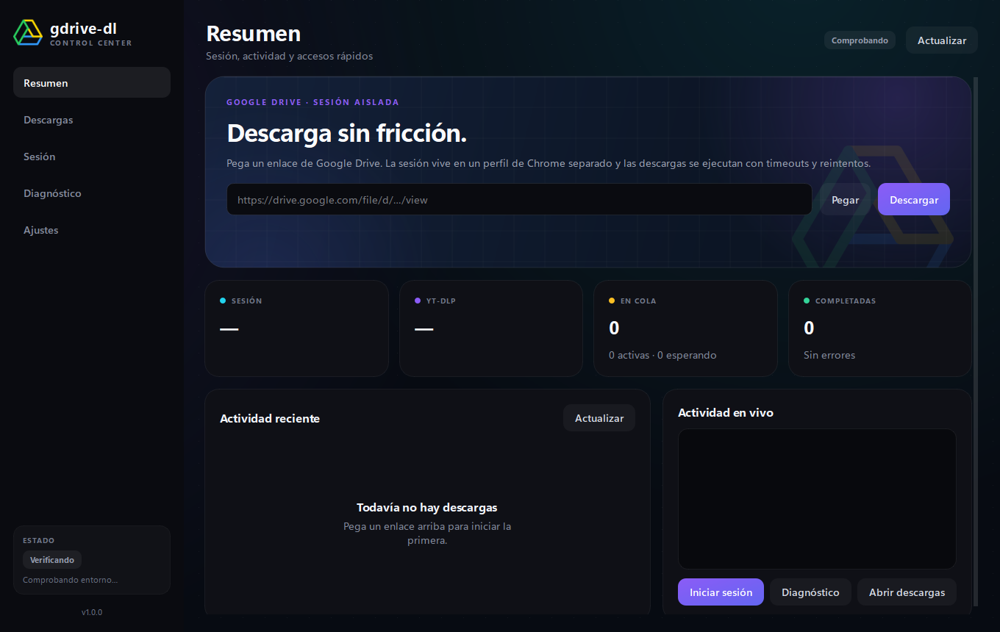

<p align="center">
  
</p>

# gdrive-dl-gui

**A native Qt control center for gdrive-dl. No HTML, no web view, no browser runtime.**

`gdrive-dl-gui` is a desktop interface for downloading private Google Drive files with the same isolated Chrome session used by `gdrive-dl`. The UI is built entirely with PySide6 widgets and custom painting. It uses a dark, Astro-inspired visual language: deep backgrounds, subtle grid lines, gradient glows, rounded cards, animated status pills, and a live activity console.

[](https://github.com/lococoi/gdrive-dl-gui/actions/workflows/ci.yml)
[](https://github.com/lococoi/gdrive-dl-gui/releases)
[](https://www.python.org/)
[](https://doc.qt.io/qtforpython/)
[](LICENSE)



## What it does

- Starts a dedicated Chrome profile and verifies the Google authentication cookies.
- Queues downloads with live status, attempts, duration, and result details.
- Streams `yt-dlp` progress and application logs into a live console.
- Exposes session, diagnostics, queue, and settings as separate dynamic pages.
- Persists preferences in `settings.json`.
- Supports drag and drop, clipboard paste, and keyboard shortcuts.
- Applies accent themes at runtime without restarting.

## No web technology

The interface is not a local web page. There is no HTML, CSS, JavaScript, Electron, Tauri, or embedded browser. The theme is implemented with Qt style sheets and `QPainter`; every view is a native widget.

## Requirements

- Python 3.11 or newer.
- Google Chrome installed.
- Windows, Linux, or macOS with a working Qt platform.
- Network access to Google Drive and PyPI.

## Installation

```bash
git clone https://github.com/lococoi/gdrive-dl-gui.git
cd gdrive-dl-gui
python -m venv .venv
```

Windows PowerShell:

```powershell
.\.venv\Scripts\Activate.ps1
python -m pip install --upgrade pip
python -m pip install -r requirements.txt
```

Linux or macOS:

```bash
source .venv/bin/activate
python -m pip install --upgrade pip
python -m pip install -r requirements.txt
```

Run the application:

```powershell
python main.py
```

Or install it as a package and use the generated command:

```powershell
python -m pip install -e .
gdrive-dl-gui
```

## First run

1. Open the **Sesión** page.
2. Select **Iniciar sesión con Chrome**.
3. Complete the Google login in the Chrome window.
4. Close every Chrome window that uses the isolated profile.
5. Return to the app and wait for the session to be verified.
6. Paste a Google Drive file link in **Resumen** and press **Descargar**.

The default data layout is:

```text
chrome_profile/   isolated Chrome profile and Google session
downloads/        downloaded files
logs/             rotating application logs
settings.json     GUI preferences
```

All four paths are ignored by Git.

## Pages

### Resumen

Gradient hero with the quick download bar, session and tool status, queue counters, recent activity, live console, and quick actions.

### Descargas

A model/view queue with animated status pills, attempts, duration, output path, context actions, and cleanup of finished items.

### Sesión

Current profile path, cookie database, authentication cookie count, verification state, and the step-by-step login flow.

### Diagnóstico

Runs the same checks as the CLI doctor: Python, Chrome, `yt-dlp`, session, output permissions, API dependencies, security, and free disk space.

### Ajustes

Profile and output directories, login and download timeouts, retries, concurrency, host policy, log level, and accent color. Settings are validated before the backend is rebuilt.

## Settings

| Setting | Default | Description |
| --- | --- | --- |
| Chrome profile | `chrome_profile/` | Isolated profile used by the login flow. |
| Downloads | `downloads/` | Destination for downloaded files. |
| Login timeout | `900` seconds | Maximum time Chrome may remain open during login. |
| Download timeout | `3600` seconds | Maximum time for a single download. |
| Retries | `2` | Additional attempts for transient failures. |
| Concurrent downloads | `2` | Queue workers and service concurrency limit. |
| Allow other hosts | disabled | Permits public URLs outside the Google Drive allowlist. |
| Accent | `violet` | Runtime accent palette. |
| Log level | `INFO` | Backend verbosity. |

Preferences are stored in `settings.json` next to the application entry point.

## Keyboard shortcuts

| Shortcut | Action |
| --- | --- |
| `Ctrl+V` | Paste a URL into the quick download bar. |
| `Ctrl+Enter` | Queue the URL in the quick download bar. |
| `Ctrl+L` | Start the Google login flow. |
| `F5` | Refresh session and tool status. |

## Architecture

The GUI is a thin presentation layer over the `gdrive_dl` package:

```text
main.py
gui/
  app.py            QApplication bootstrap and theme
  main_window.py    Shell, sidebar, pages, timers, worker orchestration
  theme.py          Accent palettes and Qt style sheet
  widgets.py        Cards, hero, pills, console, toast, animated stack
  models.py         Download queue model and status delegate
  workers.py        QThreadPool tasks, progress bridge, backend facade
  settings.py       JSON settings and core ConfigOverrides mapping
  pages/
    overview.py     Dashboard and live activity
    downloads.py    Queue table
    session.py      Chrome profile and login
    diagnostics.py  Environment checks
    settings.py     Configuration form
gdrive_dl/          Core download, session, Chrome and yt-dlp services
gdrive-dl-gui.spec  One-file windowed PyInstaller specification
scripts/build_gui_exe.py  Standalone executable build script
```

- The UI never calls `subprocess` or reads the cookie database directly.
- `GuiBackend` builds an immutable `AppConfig`, creates the core service container, and injects a Qt progress reporter.
- Long operations run in `QThreadPool` workers; results return through typed Qt signals.
- A `ProgressBridge` routes `yt-dlp` output and backend logs to the live console.
- The queue is a `QAbstractTableModel`; the status column uses a custom delegate.
- Accent changes rebuild the application style sheet and the hero gradient without restarting.

## Standalone Windows executable

The CI workflow builds a one-file windowed executable after the test job and uploads it as `gdrive-dl-gui-windows-x64`. Tags matching `v*` publish the executable in a GitHub release.

Download the latest release:

https://github.com/lococoi/gdrive-dl-gui/releases

Build locally:

```powershell
python -m pip install -r requirements-dev.txt
python scripts/build_gui_exe.py
.\dist\gdrive-dl-gui.exe
```

The executable embeds Python, PySide6, the GUI, the core services, and the latest `yt-dlp` package. It still requires Google Chrome for authentication. Profile, downloads, logs, and `settings.json` are created next to the executable unless environment variables point elsewhere.

## Development

```powershell
python -m pip install -r requirements-dev.txt
ruff check main.py gui tests scripts
mypy gdrive_dl --ignore-missing-imports
python -m unittest discover -s tests -t . -v
```

The test suite covers settings persistence, queue lifecycle, failure messages, and a headless GUI smoke test. CI runs on Windows with `QT_QPA_PLATFORM=offscreen`.

## Security and limitations

- The Chrome profile contains sensitive session cookies. Do not share or commit it.
- The GUI is a local desktop tool. It does not expose the HTTP API.
- Chrome is required for authentication; the app does not manage passwords or bypass Google challenges.
- Chrome 127 and newer can use app-bound cookie encryption. If `yt-dlp` cannot decrypt the profile, use a compatible browser/profile or export cookies.
- The application uses the installed `yt-dlp` package, so it supports the full extractor set. Other hosts remain disabled unless **Permitir hosts distintos de Google Drive** is enabled.
- The UI is optimized for desktop resolutions of 1120x720 and above.

## License

Apache License 2.0. See [LICENSE](LICENSE).

`gdrive-dl-gui` is not affiliated with Google. Google Drive, Chrome, Qt, and PySide6 are trademarks or projects of their respective owners.

---

## Español

### Una interfaz Qt nativa para gdrive-dl

`gdrive-dl-gui` es un centro de control de escritorio para descargar archivos privados de Google Drive usando la misma sesión aislada de Chrome que `gdrive-dl`. Toda la interfaz está construida con widgets de PySide6 y pintado personalizado. No usa HTML, CSS, JavaScript, Electron, Tauri ni un navegador embebido.

El tema visual está inspirado en una página moderna de Astro: fondo profundo, cuadrícula sutil, resplandores degradados, tarjetas redondeadas, píldoras de estado animadas y una consola de actividad en vivo.

### Funciones

- Perfil de Chrome dedicado con verificación real de cookies de Google.
- Cola de descargas con estado, intentos, duración y resultado.
- Consola en vivo con progreso de `yt-dlp` y logs del backend.
- Páginas dinámicas de resumen, descargas, sesión, diagnóstico y ajustes.
- Preferencias persistidas en `settings.json`.
- Arrastrar y soltar, pegar desde el portapapeles y atajos de teclado.
- Temas de acento aplicados en caliente.

### Requisitos e instalación

```powershell
git clone https://github.com/lococoi/gdrive-dl-gui.git
cd gdrive-dl-gui
python -m venv .venv
.\.venv\Scripts\Activate.ps1
python -m pip install -r requirements.txt
python main.py
```

Requisitos: Python 3.11+, Google Chrome, PySide6 y acceso a Google Drive.

### Primer uso

1. Abre la página **Sesión**.
2. Pulsa **Iniciar sesión con Chrome**.
3. Completa el login de Google.
4. Cierra todas las ventanas de Chrome que usen el perfil aislado.
5. Espera la verificación de la sesión.
6. Pega un enlace de Drive en **Resumen** y pulsa **Descargar**.

### Estructura de datos

```text
chrome_profile/   perfil aislado de Chrome y sesión de Google
downloads/        archivos descargados
logs/             logs rotativos
settings.json     preferencias de la GUI
```

### Arquitectura

La GUI es una capa de presentación sobre el paquete `gdrive_dl`:

- `gui/workers.py` construye el backend, ejecuta tareas en `QThreadPool` y conecta el progreso con Qt.
- `gui/models.py` implementa la cola como `QAbstractTableModel` y pinta los estados con un delegado.
- `gui/widgets.py` contiene las tarjetas, el hero, las píldoras, la consola, los toasts y la pila animada.
- `gui/pages/` contiene cada vista como un widget independiente.
- `gdrive_dl/` contiene la lógica de sesión, Chrome, `yt-dlp`, reintentos, timeouts y validación.

### Ejecutable Windows autocontenido

El CI compila un ejecutable windowed de un solo archivo después de las pruebas y lo publica como `gdrive-dl-gui-windows-x64`. Los tags `v*` publican el ejecutable en una release de GitHub.

Descarga la última release:

https://github.com/lococoi/gdrive-dl-gui/releases

Build local:

```powershell
python -m pip install -r requirements-dev.txt
python scripts/build_gui_exe.py
.\dist\gdrive-dl-gui.exe
```

El ejecutable incluye Python, PySide6, la GUI, los servicios del core y el paquete `yt-dlp` más reciente. Sigue necesitando Google Chrome para autenticarse. El perfil, las descargas, los logs y `settings.json` se crean junto al ejecutable salvo que las variables de entorno indiquen otra ruta.

### Desarrollo

```powershell
python -m pip install -r requirements-dev.txt
ruff check main.py gui tests scripts
mypy gdrive_dl --ignore-missing-imports
python -m unittest discover -s tests -t . -v
```

### Seguridad y límites

- El perfil de Chrome contiene cookies sensibles; no debe compartirse.
- La GUI es una herramienta local y no expone la API HTTP.
- Chrome es obligatorio para autenticarse.
- Chrome 127 y posteriores pueden usar cifrado de cookies vinculado a la aplicación; si `yt-dlp` no puede descifrarlas, usa un perfil compatible o exporta las cookies.
- La aplicación usa el paquete completo de `yt-dlp`; otros hosts siguen bloqueados salvo que se active la opción correspondiente.

### Licencia

Apache License 2.0. Consulta [LICENSE](LICENSE).

`gdrive-dl-gui` no está afiliado a Google. Google Drive, Chrome, Qt y PySide6 son marcas o proyectos de sus respectivos propietarios.
